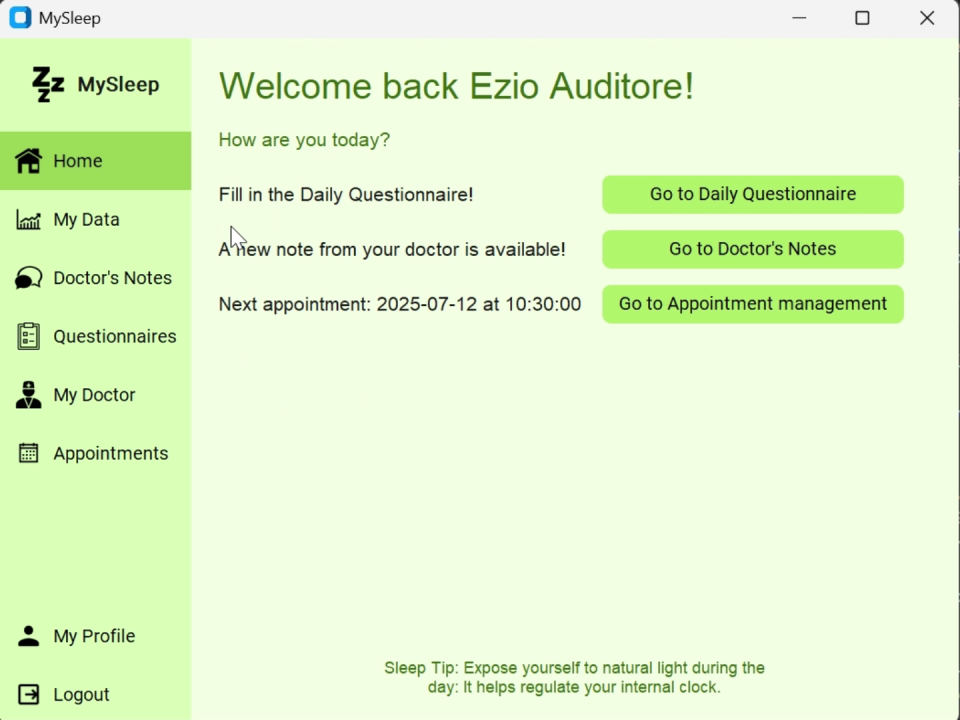
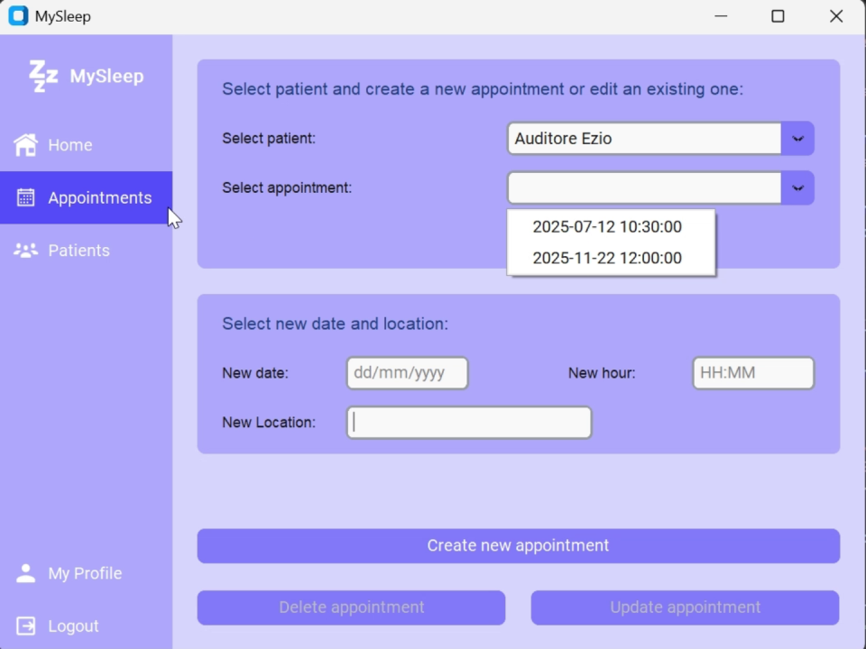

# MySleep — Sleep Monitoring & Patient Management

**Academic software project · Information Bioengineering · Politecnico di Milano**

MySleep is a desktop application prototype for managing **sleep-related information and communication between patients and healthcare professionals**. Developed with Python, CustomTkinter and SQLite, it combines role-specific interfaces with sleep questionnaires, physiological data visualization, prescriptions, notes and appointment management.

> **Academic prototype** — demonstrated using fictional accounts and synthetic records. Not a clinical product or a validated sleep assessment tool.

## Demo

**[▶ Watch the complete MySleep application demo (3 min 26 s)](media/mysleep-full-demo.mp4)**

The recording preserves the **entire original walkthrough**, including both doctor and patient interfaces. It was compressed and cropped to remove unused black borders, without removing any scenes.

### Interface preview

| Patient dashboard | Doctor appointments |
|---|---|
|  |  |

Additional screens: [Sleep data and trends](media/screenshots/sleep-data-trends.png) · [Patient notes](media/screenshots/patient-notes.png).

## Features

- **Patient interface:** Account profile, sleep questionnaires, sleep-data summaries, doctor messages/notes and appointments.
- **Doctor interface:** Patient selection, appointment management, prescription records, notes and physiological-data views.
- **Sleep tracking:** Stored questionnaire responses and visual summaries of heart rate, oxygen saturation and blood pressure when demo measurements are available.
- **Data management:** SQLite-backed storage for users, patients, clinicians, appointments, prescriptions, questionnaires and sleep summaries.

## Technologies

| Area | Tools |
|---|---|
| Programming | Python |
| Desktop interface | CustomTkinter, Tkinter |
| Database | SQLite, SQL |
| Image handling | Pillow |
| Data visualization helpers | Matplotlib |

## Repository structure

```text
app/
  AppFinale.py            Original desktop GUI and application logic
  data_processing.py     Selected synthetic-data and plotting helpers
  test_images/           Original GUI icons and images
scripts/
  setup_demo.py          Copy the sanitized demo DB to a local working database
  run_demo.py            Initialize (if needed) and launch the application
db/
  schema.sql             Database schema for an empty installation
  init_empty_db.py      Empty-database initializer (no accounts)
sample_data/
  MySleep_demo.db        Fictional sample accounts and demonstration records
  signal_traces/         Generated synthetic readings used by demo views
  plots/                 Generated synthetic plots used by demo views
media/
  mysleep-full-demo.mp4  Full 3:26 walkthrough, compressed
  screenshots/           Screenshots extracted from that walkthrough
docs/
  ARCHITECTURE.md        System overview and data model
  LIMITATIONS.md         Security, scope and reproducibility limitations
  MySleepReport.pdf      Full report of the Project
requirements.txt
.gitignore
README.md
```

## Run locally

**Requirements:** Python 3.10+ and a local desktop environment with GUI support. The original application was developed on Windows; these instructions are best suited to Windows.

From the repository root:

```powershell
py -m venv .venv
.\.venv\Scripts\Activate.ps1
python -m pip install -r requirements.txt
python scripts/run_demo.py
```

On first launch, the script copies `sample_data/MySleep_demo.db` into a local `MySleep.db` file. Subsequent launches retain your local changes. To restore the original synthetic data:

```powershell
python scripts/setup_demo.py --reset
```

**Example demo logins** (fictional accounts; password for both: `1234`):

| Role | Email |
|---|---|
| Doctor | `doctor1@example.com` |
| Patient | `patient4@example.com` |

These are intentionally weak **demo-only** credentials; do not reuse them with real data.

To initialize an **empty** database instead, run `python db/init_empty_db.py`. An empty database has no users and cannot demonstrate role-specific views until accounts are created.

## Scope and project notes

This repository preserves the original GUI and representative supporting utilities. The data fixture is derived from the supplied **fictional** academic demonstration database; identifying fields were replaced with `example.com` addresses and placeholder identifiers. The signal traces and plots are newly generated synthetic illustrations, not clinical measurements. No virtual environment, raw patient data, or original machine-specific paths are included.

Some workflows still reflect academic prototype assumptions. The code has not been validated for clinical use, and authentication, query handling and input validation require further hardening. See [Limitations](docs/LIMITATIONS.md).

## Authors

Ketrin Mehmeti, Giorgia Moroni, Matteo Frassetto, Andrea Guidi, Alessandro Lima, Francesco Margutti | Politecnico di Milano
