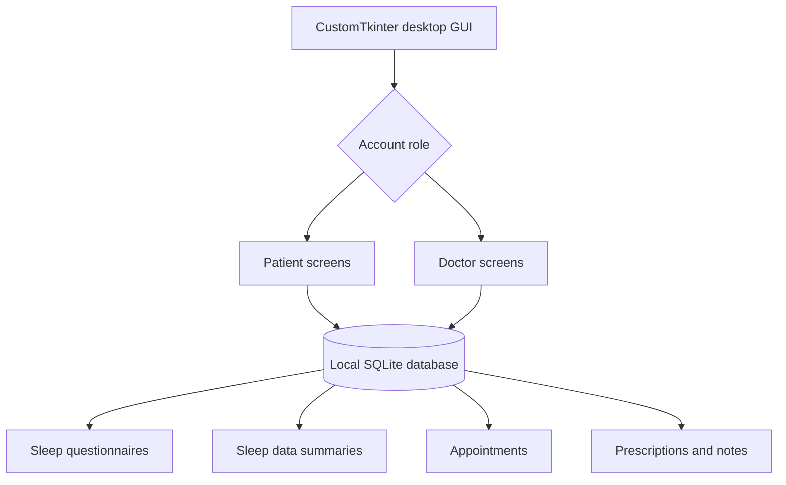

# Architecture and data model

MySleep is a locally executed desktop prototype. `app/AppFinale.py` implements the CustomTkinter UI and calls SQLite directly; it is not a web service and does not use a deployed server.

### Data model

The original database contains 11 application tables: `user`, `patient`, `doctors`, `appointments`, `prescriptions`, `notes`, `Questionnaire`, `DataSummary`, `device`, `software_daily_report`, and `Tips`. `db/schema.sql` provides the empty schema; `sample_data/MySleep_demo.db` includes the fictional demonstration rows.

### Design decisions

- A role flag distinguishes patient (`P`) and doctor (`D`) UI paths.
- The application reads/writes directly to a local SQLite database.
- Sleep-data views reference companion text traces and plot images stored under `sample_data/`.
- The standalone `app/data_processing.py` includes selected original utilities for simulated time-series processing and visualization.

This description documents the original application, rather than endorsing its authentication design for real clinical usage.
